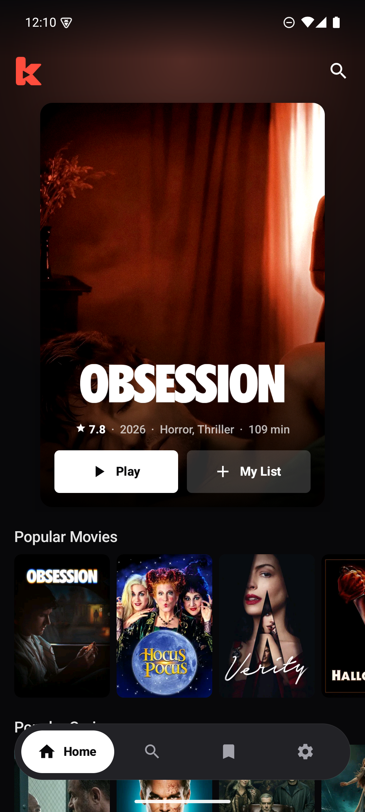
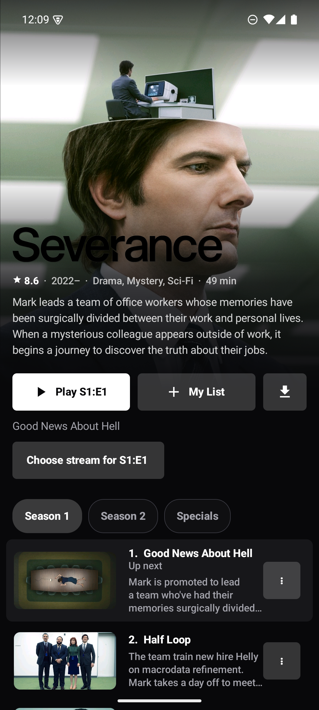
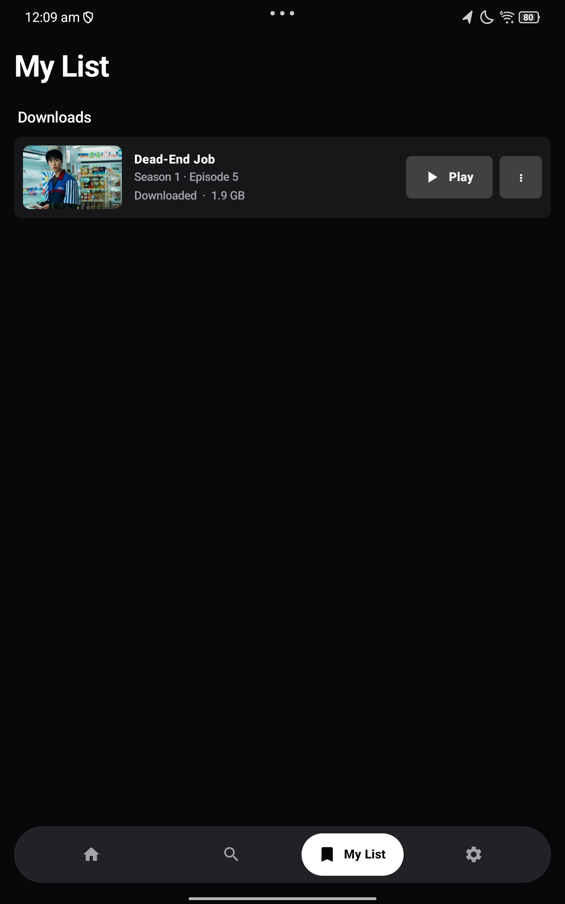

# Kino

<p>
  
</p>

A very light way to watch what your Stremio-style addons provide, on Android TV and phones. One APK of about 4 MB.

- **Netflix-style browsing.** As you move around, the title you're on fills the screen, with rows of posters below.
- **Works with your addons.** Add any Stremio addon link, or sign in to your **Nuvio** account to bring your addons, My List and Continue Watching with you.
- **Two steps to playing.** Pick a title and press Play: Kino picks the best stream for your screen, or choose another from the list under it. Resume where you stopped, on any device.
- **Watch offline.** Download movies or individual episodes, then play them from My List.
- **Clear series progress.** See the episode title and time left, browse seasons, or choose another stream from the episode menu.
- **TV first.** Everything works with a remote. Voice search works on remotes with a mic.

Kino hosts no content and isn't affiliated with Nuvio or Stremio. A fresh install comes with Cinemeta (catalogs and details only); streams come from addons you add.

## Screenshots

<table>
  <tr><th>Home</th><th>Series and episodes</th><th>Offline downloads</th></tr>
  <tr>
    <td></td>
    <td></td>
    <td></td>
  </tr>
</table>

Captured from the running Android app: Home and series on a phone emulator, Downloads on a Lenovo Legion tablet. Title artwork belongs to its owners.

## Install

Download the signed APK from [the latest release](https://github.com/krishnanunnir/kino/releases/latest) and open it on your phone or TV. On a TV, a downloader app or `adb install kino.apk` works.

## Using it

- **Sign in to Nuvio:** Settings → Sign in to Nuvio. A code appears; open nuvio.tv/link on your phone and enter it. Or use your email and password.
- **Add an addon:** Settings → Add an addon, then paste the addon's `manifest.json` link.
- **Use another player:** Settings → Player switches between Kino's player and any video app you have (VLC, mpv, Just Player).

Kino plays direct stream links. Torrent-only results are hidden, because Kino doesn't ship a torrent engine.

## Building

JDK 17 and the Android SDK (platform 35).

```bash
./gradlew assembleRelease
```

Release signing reads a git-ignored `keystore.properties` (`storeFile`, `storePassword`, `keyAlias`, `keyPassword`). Without it, the APK builds unsigned. Keep the keystore and its passwords backed up privately: Android updates must use the same signing key.

```bash
./gradlew testDebugUnitTest
```

### How it's built

Plain Kotlin and Android Views; the platform's own HTTP, JSON and storage. The real dependencies are Media3 ExoPlayer and Material Components. Files in `app/src/main/java/app/kino/`:

| File | What it does |
|---|---|
| `Addons.kt`, `Meta.kt` | Stremio addon protocol: manifest, catalog, meta, stream |
| `Nuvio.kt` | Nuvio account: sign-in (email or TV code), pulling addons, My List and progress, pushing changes |
| `Store.kt` | Progress, My List and settings on the device |
| `MainActivity.kt`, `Pages.kt` | Home, Search, My List, Settings |
| `DetailsActivity.kt`, `Streams.kt`, `PlayerActivity.kt` | Title and its streams → playback |
| `Ui.kt`, `Posters.kt`, `Images.kt` | Palette, type, focus, poster rows, image cache |

`PRODUCT.md` and `DESIGN.md` hold the product and design decisions. The logo lives in `assets/branding/`; the app's icon, TV banner and wordmark are vector copies of it in `res/drawable`.
